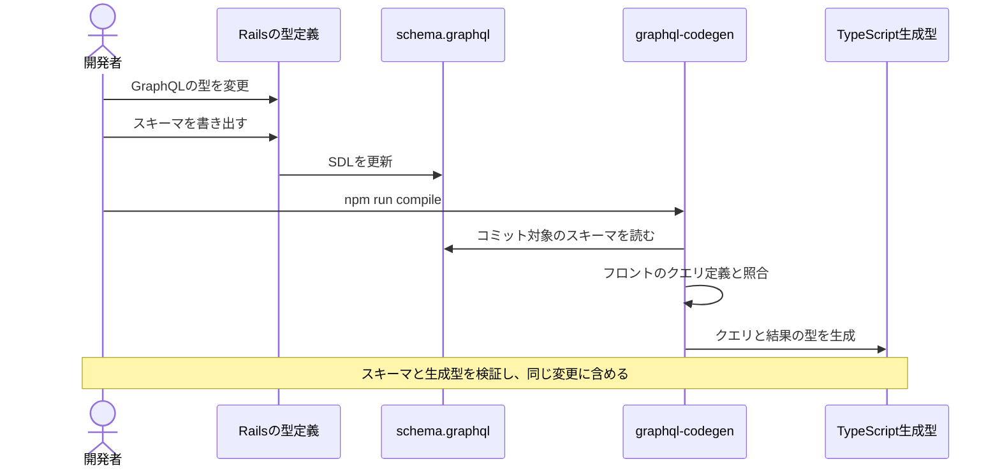
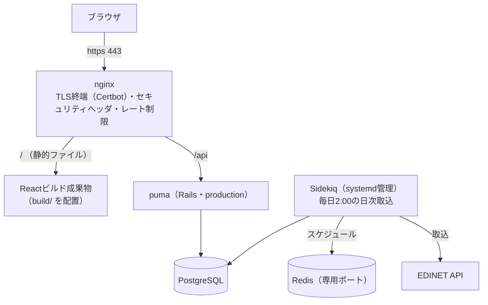
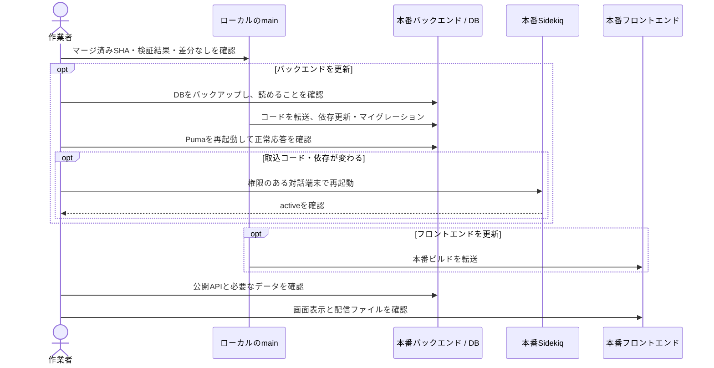
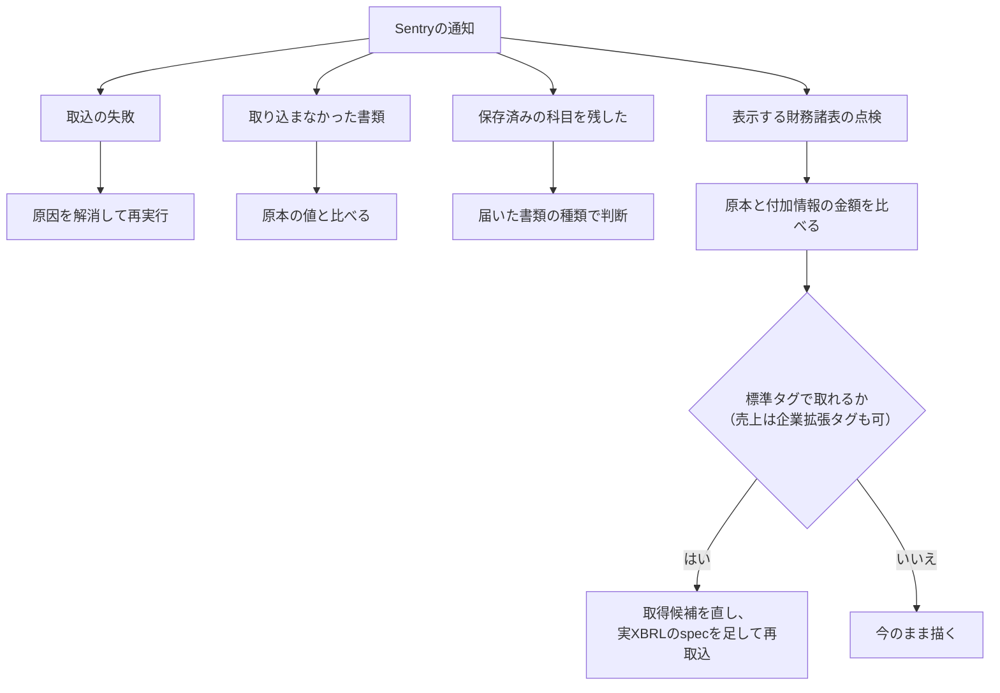

# 04. 開発と運用

この章では、変更時の検証、本番への反映、取込障害からの復旧を扱う。

| 手順 | 参照先 |
|---|---|
| セットアップ・起動・データ投入 | [ルートREADME](../../README.md) |
| バックエンドの起動・環境変数・テスト | [backend README](../../application/backend/README.md) |
| フロントエンドの検証・ビルド | [frontend README](../../application/frontend/README.md) |

## 開発

### GraphQLスキーマの変更

スキーマはAPIで扱う項目と型の定義。変更後は、画面側で使うTypeScriptの型も生成し直す。

<a id="sequence-codegen"></a>



| 確認すること | 内容 |
|---|---|
| 実行コマンド | backendで`bundle exec rake graphql:dump_schema`、frontendで`npm run compile`を実行する |
| 生成元 | コミット済みの`application/backend/schema.graphql`とフロントのクエリ定義。バックエンドの起動は不要 |
| 型の対応 | 金額の`Money`はTypeScriptの`number`に対応付ける |
| 生成結果 | CIで生成し直して差分が出ないことを確認する |
| APIの上限 | Web・Chrome拡張のクエリが複雑度・深さの上限内に収まるか実行して確認する。 |

CIは変更した側だけ本体ジョブを実行する。変更していない側のskipは、検証済みを意味しない。

### backend変更時のローカル検証

実XBRLフィクスチャを使うspecは、入力がGit管理外のためCIではpendingになる。この範囲はbackend変更時に、コミット・PR作成前のローカル実行で確認する。

```bash
docker compose exec appserver bash -c 'cd /home/app/financialStatement && bundle exec rspec $(grep -rl xbrl_fixture spec --include="*_spec.rb")'
```

- `0 failures` だけでなくpendingがないことを確認する。不足する入力は [フィクスチャの手順](../../application/backend/spec/fixtures/xbrl/README.md) に従って用意する。

### 指標用データの追加後の再取込

DBマイグレーションだけでは、既存書類の追加科目は埋まらない。バックアップとバックエンドの反映・再起動後に、必要なタスクを実行する。

| 追加するデータ | コマンド（backendで実行） | 再実行時の扱い |
|---|---|---|
| 期首総資産・期首自己資本・期末自己資本 | `bundle exec rake ingestion:reingest_indicators` | 不足する科目を持つ対応済み有報が対象。原本で未開示なら対象に残るため、日次ジョブには加えない |
| 企業公表ROE | `bundle exec rake ingestion:reingest_disclosed_roe` | 抽出未確認の有報が対象。未開示でも確認済みになり、途中失敗分は再実行できる |

- 有報全体を再取得して科目を更新する。EDINETへの負荷を避けるため、間隔を空けた逐次実行を維持する。
- 残った欠損は、原本の未開示・未対応形式・取得失敗を区別する。期首残高を期末残高で代用しない。
- 反映後は公開APIと実際の一覧で、既存書類の指標表示を確認する。

## 本番環境の構成

さくらVPS1台に全コンポーネントが同居する。開発環境（Docker）と違いコンテナは使わず、OS上に直接構築されている。



| 項目 | 内容 |
|---|---|
| 本番nginxの設定 | **リポジトリ外**（サーバ上の `/etc/nginx/` 直下）にあり、rsyncデプロイの対象外。変更はサーバ上で直接行う |
| フロントエンド | devサーバではなく、ビルド済み静的ファイルをnginxが直接配信する。SPAのフォールバック設定（未知パス→index.html）は本番nginx側の責務 |
| セキュリティヘッダ | nginxで一元管理し、Rails側のヘッダ出力は明示的に止めている（二重出力防止） |
| HTTPS | Certbot（Let's Encrypt）による301リダイレクトとTLS終端。Railsの `force_ssl` は使わない（nginxが `X-Forwarded-Proto` を転送しておらず、有効化すると無限リダイレクトになる） |
| レート制限 | `/api/` が対象。未認証・公開APIの防御の一部 |

## デプロイ

自動デプロイはなく、**ローカルの作業ツリーをrsyncでVPSへ転送して再起動する**方式。



rsyncは未コミットの変更も転送するため、マージ済みのmainと差分のない作業ツリーを使う。バックアップは転送時の削除対象外に保存する。

フロントが新しいAPIに依存し得るため、**バックエンド → フロントエンド**の順に反映する。追加科目が必要なら、フロントの反映前に[再取込](#指標用データの追加後の再取込)も行う。

## 日次バッチの監視とリカバリ

毎日、次の4つを確認する。失敗した日付・書類を見つけたら、原因を確かめてから必要な分だけ再実行する。

| 確認先 | 見ること |
|---|---|
| Sentry | 本番環境の例外と警告。デプロイなどでプロセスを止めたときの終了（`SystemExit`・`SignalException`）は送らない。URLにEDINET APIキーが含まれるため、リクエストの内容は送らない |
| ログ | ジョブの実行とエラー。`log/production.log` に書き、SQLのログは別ファイルにする。どちらもサイズの上限を決めてローテーションする |
| 取込件数 | EDINETの提出一覧と比べる。訂正有報は元の有報の日付で保存されることがあるため、前日の件数が0でも取込の失敗とは限らない |
| 公開API | 正常に応答するか |

Sentryの通知は、取込のどの段階で起きたかで対応が分かれる。



取込の失敗以外の通知は、文言の固定部分でSentryの課題にまとまる（fingerprintに指定）。書類ごとの値は次の場所にある。多くの書類を一度に再取込すると、同じ種類の通知がまとめて届く。

| 通知 | 文言の形 | 書類ごとの値 |
|---|---|---|
| 照合の警告（`revenue …`・`profit and loss …`・`balance sheet …`・`cash flow …`） | 固定 | 付加情報（extra）のdocID・連結区分・表示形式・照合した金額 |
| それ以外 | `文言: docID (値)` | 文言の `:` より後 |

### 取込の失敗

Sentryに例外が届き、ログに日付か書類IDが残る。

| 失敗した処理 | ログ | 再実行 |
|---|---|---|
| 書類一覧の取得。その日の書類をすべて取り込んでいない | `list failed <日付>` | 原因を解消してから `rake 'ingestion:backfill[日付,日付]'` |
| 書類1件の取込 | `ingest failed <docID>`（Sentryでは `document_id` タグ） | `rake 'ingestion:documents[docID]'` |

EDINETの応答が原因のときは、続けて再試行しない。メンテナンス情報を確かめてから再実行し、失敗が続くときはAPI仕様の変更を確かめる。

| EDINETの応答 | 意味 |
|---|---|
| 404 | 書類を取得できない |
| 403・429 | アクセス制限 |
| 200 | 本文にエラーが入っていることがある |
| リダイレクト | API仕様にない応答のため追わない。一覧は `EDINET documents.json failed`、書類は `EDINET document redirected` で失敗にする |

### 取り込まなかった書類

対象確認で取り込まないと決めた書類。

| 通知 | 理由 | 対応 |
|---|---|---|
| `accounting standard unknown` | 会計基準が未知 | 対応不要。頻繁に届くなら形式の対応を検討する |
| `invalid edinet code in DEI` | DEIのEDINETコードが空か、英大文字1字と数字5桁の形でない。企業を識別するキーのため、他社のデータを上書きしないよう取り込まない | 括弧内の値と原本の `EDINETCodeDEI` を比べる。原本の誤りなら対応不要。読み取りの誤りなら、読み取りを直して `rake 'ingestion:documents[docID]'` |
| `sec code mismatch` | 書類一覧の証券コード（`list=`）とDEIの証券コード（`dei=`）が違う。なりすましや提出の誤りで他社のデータを上書きしないよう取り込まない | 原本とEDINETの書類の画面で、正しい証券コードを確かめる。`documents` で取り込むと、最新期の有報なら企業マスタの証券コードが `dei=` の値になるため、`dei=` が正しい書類だけ取り込む |

`sec code mismatch` を照合するのは日次取込と `backfill` だけで、`documents`・`reingest_*` は一覧と照合しない。DEIの証券コードが空で、企業と会計期間が同じ保存済みの書類があるときは、`dei=` は企業マスタの証券コード（上場廃止後は空のこともある）になる。

### 保存済みの科目を残した

`skip empty extraction for existing statement` は、再取込（訂正有報、または同じ書類の取り直し）で、括弧内の連結区分の当期の科目が1つも取れず（期首残高だけの場合を含む）、保存済みの形式と科目を残したことを示す。有報のdocID・提出日などは新しい書類で更新している。

| 届いた書類 | 対応 |
|---|---|
| 訂正箇所だけのXBRLを含む訂正有報 | 対応不要 |
| 連結をやめたことを示す訂正書類 | 旧連結の財務諸表を削除し、単体は保存済みの科目を残すため、一覧から書類が消えることがある。表示対象を確かめる（原本の内容が同じなら、再取込しても直るとは限らない） |
| 財務諸表を含む書類 | 形式判定や取得候補の誤りを原本で確かめる |

### 表示する財務諸表の点検

取り込んだ後、画面に出す財務諸表（連結があれば連結）を点検する。

| 通知 | 内容 | 直す場所 |
|---|---|---|
| `primary statement missing bs.assets` | 資産合計が取れていない | 対応表か形式判定 |
| `revenue does not match summary of business results` | 売上が[経営指標の要約の売上](02_data_flow.md#売上と経営指標の要約の照合)と一致せず、一致する取得候補もない。売上のタグが内訳だけか、取り違えている | 売上の取得候補（差し替えのときだけ使う候補は `replacements:`） |
| `revenue missing although summary of business results has revenue` | 要約に売上があるのに、損益計算書の売上が取れない | 売上の取得候補（企業拡張タグなら[売上の一覧](05_taxonomy_mapping.md#売上収益)） |
| `profit and loss chart expenses do not reconcile` | 費用の科目が、日本基準は[売上と](02_data_flow.md#業種による費用の違い日本基準のpl)、IFRSは[売上原価＋販管費と](02_data_flow.md#赤字と差額の表示武田薬品のpl)一致しないまま描いた | 費用の取得候補 |
| `balance sheet chart does not reconcile with totals` | 借方の科目の合計が資産合計と、または資産合計が負債合計＋純資産合計と一致しないまま描いた。前者は描いていない資産の科目があり、後者はタグを取り違えたおそれがある | 取得候補と借方の科目 |
| `cash flow does not reconcile with closing balance` | [CFの式](02_data_flow.md#表示前の確認)が成り立たない。原本の行のうち、式に入っていないものがある | 取得候補と式 |

企業拡張タグにしかない費用・CFの行や、差額でしか描けないBSの科目は、今のまま描く。

### 取込の対応を広げた後の再取込

| きっかけ | コマンド | 対象 |
|---|---|---|
| 新しい業種・形式に対応した | `rake 'ingestion:reingest_unsupported[提出日from,提出日to]'` | `unsupported` の財務諸表を含む有報 |
| 詳細タグ義務化前のIFRS有報が `ifrs_liquidity` のまま残っている | `rake ingestion:reingest_ifrs_summary` | 表示対象の `ifrs_liquidity` なのに資産合計がない有報。移行が終われば0件になり、再実行しても何もしない |
| 連結に貸借対照表だけがある有報で、単体を表示するようにした | `rake ingestion:reingest_balance_sheet_only_consolidated` | 連結を表示しているが、連結に当期の損益・CFの科目がなく、単体にはある有報。移行が終われば0件になり、再実行しても何もしない |
